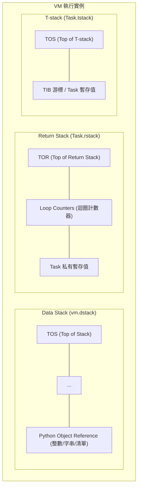
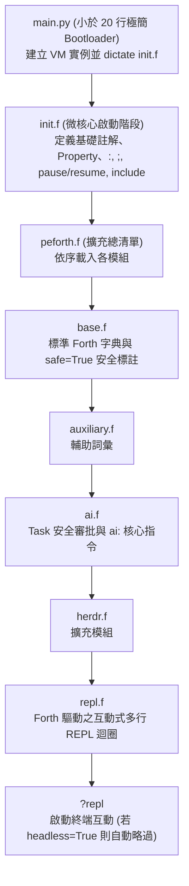
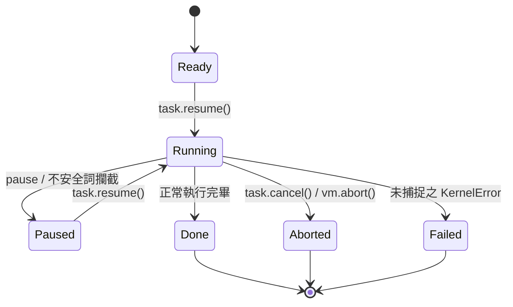
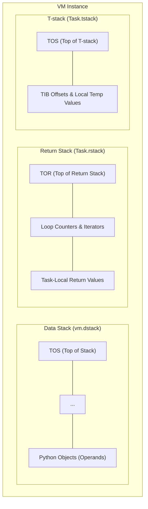
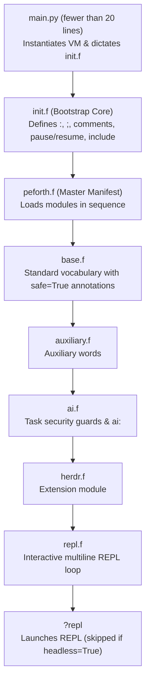
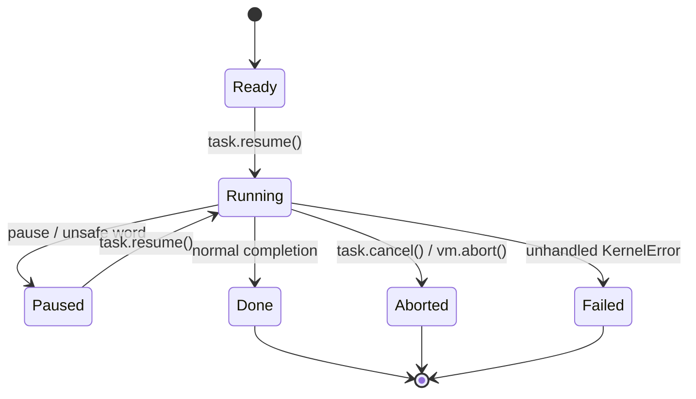

- peforth manual.md
- peforth manual (English).md
- ai.md

# peforth v2.1.0 共用 Forth Kernel 技術手冊與架構設計理念

> **版本**：peforth v2.1.0 核心技術架構規範手冊
> **適用環境**：Python 3.10+ / Linux, WSL, Windows
> **核心源碼**：`main.py`, `init.f`, `peforth.f`, `projectk.py`, `base.f`, `auxiliary.f`, `ai.f`, `herdr.f`, `repl.f`, `ai.py`

---

## 序言：極簡主義與現代技術的相遇

在電腦科學的演進史中，Forth 代表著一種登峰造極的極簡美學：以 stack 為核心的虛擬機、零語法開銷、純粹的後綴表示法，以及完全開放Compiler內部狀態的 Metaprogramming 威力。隨著現代軟體工程的發展，Python 等語言帶來了Object Reference、自動記憶體管理、豐富的資料結構與第三方函式庫。這些成果為 Forth 提供了新的發展方向：在保有簡潔與可擴充特色的同時，也能直接運用現代 Host Language 的能力。

**peforth (Python Edition)** 延續 Forth 的設計精神，並探索它與現代程式語言相互結合的架構範式：
**當 Forth 的多 Stack 拓撲與 Metaprogramming 靈魂，直接運行於 Python 這種具備豐富物件生態與動態特性的 Host Language 之上，會帶來何種可能？**

在 **peforth v2.1.0** 中，這個理念進一步落實為清楚的分工：

> **「Forth drives Forth; Python provides host primitives.」**
> （Forth 驅動 Forth 核心邏輯；Python 專注提供底層 Host 原語。）

在 2.1.0 中，系統將互動流程的主導權交由 Forth，並以極簡的 小於 20 行引導程序（`main.py`）喚醒無依賴微核心（`projectk.py`），透過 `init.f` 逐步建構出完整的Compiler與Loader，並最終由 Forth 自行控制 REPL 互動迴圈（`repl.f`）與 AI 助理協同流程。

本手冊是 peforth 2.1.0 的系統架構手冊與設計理念記錄。本手冊**不做**傳統 Forth 語法的入門字典（各 Word 本身已內建 `help` 與 `comment` 自我文檔），而是深入剖析 peforth 如何用一個僅數百行程式碼的微核心，在動態物件世界中重建純粹的 Forth 哲學，並說明 Coroutine 與 AI 協同安全機制如何融入 Forth 的執行模型。

> [!TIP]
> **想直接動手跑起來？**
> 若您希望立即在終端機操作、執行互動 REPL 或設定環境變數與多模型配置，請參閱 repository 根目錄的 [README.md](../../README.md) 以及 [AI User Manual](ai.md)。
> 本手冊（Manual）聚焦 peforth 的核心架構設計理念；安裝與環境配置請以 README.md 為準。

---

## 第一章：設計理念與架構概述 (Design Philosophy & Architecture)

### 1.1 現代程式語言的發展與 Forth 的新契機

傳統 Forth（如 FIG-Forth、Forth-79/83 與 ANS Forth）以簡潔的 Stack 架構、靈活的編譯機制與自我延展性著稱。隨著現代程式語言的發展，Python 等語言帶來了許多值得借鏡的新技術，為 Forth 提供了進一步發展的機會：

1. **現代物件與記憶體管理**：傳統 Forth 的線性記憶體模型適合裸機與資源受限的環境；Python 則提供自動記憶體管理（Garbage Collection）與Object Reference機制，使 Forth 在現代 Host 上也能直接共享並操作高階物件。
2. **豐富的資料型別與結構**：傳統 Forth 的 cell 與 Stack 操作簡潔而直接；Python 原生支援動態字串、List、Dictionary、Class 等資料結構，讓 Forth 可以直接運用這些成熟能力，擴展資料表達方式。
3. **龐大的軟體生態系**：Python 擁有豐富的第三方函式庫，涵蓋科學計算、機器學習、網路通訊與作業系統整合等領域。Forth 可以直接借助這些資源，拓展應用範圍。

**peforth 的設計理念：保留 Forth 的精髓，引進現代語言的能力——共生微核心 (Symbiotic Micro-Kernel)**
* **共享物件空間**：peforth 的 stack 上流轉的除了傳統的整數或指標，也可以是**Python Object Reference**（整數、浮點數、字串、清單、字典、生成器乃至自訂 class 實例）。
* **Forth 與 Host 各展所長**：Forth 保留其無可匹敵的流程中樞控制力、自訂 DSL 能耐與 Metaprogramming factory；而重型運算、系統 API、字元編碼與巨量庫則直接由 Python 全權支撐。

---

### 1.2 多 Stack 虛擬機架構 (Multiple-Stack VM)

peforth 以多個 stack 分工保存運算資料與 Task-local 控制狀態：Data Stack 在同一個 VM 內共享；Return Stack 與 T-stack 則各自屬於目前 Task。



1. **Data Stack (`vm.dstack`)**：
   * 運算元的流通中心與參數傳遞管線。
   * 物理實作為 Python 原生 `list`。所有的推入 (`push`) 與彈出 (`pop`) 均受到邊界保護；當 stack 為空而嘗試 pop 時，由 Python 層級直接拋出明確的 `KernelError: Invalid data stack depth (or empty stack)`，讓錯誤更容易辨識與處理。
2. **Return Stack (`Task.rstack`)**：
   * **Task Private 私有資源**：每個 Task 擁有專屬獨立的 `rstack`（物理存儲於 `Task.rstack`，透過 `vm.rstack` 代理動態路由至當前活躍 Task）。
   * 用於計數迴圈計數器暫存（如 `for ... next / aft`）與程式流程的臨時中轉（`>r`, `r>`, `r@`, `rdrop`）。
   * 即使某個 Task 在迴圈內部呼叫 `pause` 暫停，其迴圈狀態與計數器仍安穩封裝於該 Task 的私有 `rstack` 中；其他 Task 擁有自己的 `rstack`，彼此不會踩踏。
3. **T-stack (`Task.tstack`)**：
   * **Task Private 私有資源**：每個 Task 擁有專屬的暫存堆疊，可用於存放 TIB 游標位移或剖析器的臨時檢查點。透過 `>t`、`t@`、`t>` 進行操作。

#### Stack Effect 標記慣例
在無型別語法的後綴世界中，Stack Effect 註釋是理解程式不變式的命脈。peforth 以標準形式標示各 stack 的輸入與輸出，top of the data stack (TOS) 恆在最右側：
```forth
\ 單純操縱 Data stack
( a b -- c )

\ 跨越 Data stack 與 Return stack
( x -- ) ( R: -- x )

\ 操縱 Task-local T-stack
( x -- ) ( T: -- x )
```

---

### 1.3 微核心不變式 (Micro-Kernel Invariants, `projectk.py`)

peforth 2.1.0 的微核心嚴格恪守以下設計不變式：
1. **零外部依賴 (Zero External Dependencies)**：
   `projectk.py` 全長僅約 450 行，且僅導入 Python 標準函式庫模組（`dataclasses`, `inspect`, `io`, `re`, `tokenize`），保持核心獨立於外部 UI、網路或終端格式化套件。
2. **極致種子狀態 (Minimal Seed State)**：
   核心在 Python 啟動時僅宣告 **兩個原生種子詞**：`code` 與 `end-code`。所有其他語彙（包含冒號Compiler `:`、分號 `;`、條件跳轉 `if`、`else`、`then` 以及立即詞標記 `immediate`）皆在 `init.f` 啟動階段由 Forth 源碼自身編譯建立。
3. **統一異常階層**：
   核心所有錯誤統一繼承自 `KernelError`，提供一致且可預測的錯誤捕捉機制。

---

## 第二章：開機載入鏈與系統架構 (Bootstrapping Chain)

在 peforth 2.1.0 中，系統啟動展現了極高的結構秩序感：



### 各模組職責劃分

1. **`main.py`** (小於 20 行)：
   僅負責設定 `vm.host["__file__dir__"]`，並調用 `vm.dictate("init.f")`。讓互動迴圈與命令分派由 Forth 負責。
2. **`init.f`**：
   在純粹的微核心之上，由 Forth 語法逐一構築關鍵基礎設施：
   - 註解與文件詞：`\`, `(`, `//`, `///`
   - Word 物件屬性賦予：`last`, `::`
   - 冒號Compiler：`:`, `;`, `immediate`
   - 堆疊常數輔助詞：`true`, `false`, `rest`
   - 協同 Task 控制詞：`pause`, `resume`, `abort`, `bye`
   - Loader：`include`
   - **最後一行嚴格指向**：`include peforth.f`。
3. **`peforth.f`**：
   系統的 Extension Manifest，依序載入 `base.f`、`auxiliary.f`、`ai.f`、`herdr.f` 與 `repl.f`，最後定義並調用 `?repl`。若環境設定 `vm.host["headless"] = True`，則可供自動化測試或第三方應用安全 import，不致卡在終端輸入。
4. **`repl.f`**：
   **Forth 驅動的互動式 REPL**。以 `code repl` 實作，內建多行貼上累計、狀態感知提示詞（`chat>`、`>`、`... `），並整合 `prompt_toolkit` 快捷鍵，同時具備 Python 標準 `input()` 的平滑降級備援機制。

---

## 第三章：記憶體、Stream 與 PAD 哲學

傳統 Forth 依賴連續平坦的線性位址空間與稱為 `PAD` 的臨時記憶區。在 peforth 中：

* **無平坦 byte array 沙盒**：字串與二進位資料直接使用 Python 原生的 `str`、`bytes` 或 `io.StringIO` 串流，善用 Host 的記憶體管理與字串處理能力。
* **Task 私有 TIB (Terminal Input Buffer)**：每個 Task 擁有獨立的輸入緩衝區與游標指針。Forth 的 `word`、`parse` 與 `char` 均直接從當前活躍 Task 的輸入串流中精準提取 Token。
* **編譯期位址回填**：冒號定義編譯後的產物是存放於 `vm.frame.colon_code` 中的步驟清單。控制流的分支指令（`branch`, `0branch`, `doNext`）儲存的是指向清單中索引步驟的整數 offset，無須計算二進位記憶體位移。

---

## 第四章：控制結構與非平坦位址回填機制

在 peforth 中，控制結構不是寫死在Compiler裡的硬編碼語法，而是由具備 `immediate` 屬性的立即詞在編譯期動態回填跳轉目標：

```forth
\ 條件分支
condition if true-branch else false-branch then

\ 不定次數迴圈
begin condition while body repeat
begin body condition until
begin body again

\ 計數迴圈 (支援 aft 首輪略過語法)
10 for r@ . next cr
10 for aft r@ . then next cr
```

`if` 會在編譯期記錄當前位置並預留分支指令，待 `else` 或 `then` 出現時，再將正確的跳轉位移精確回填至先前的指令槽位中。這展示了 Forth 開放Compiler架構的簡潔與強大。

---

## 第五章：字典架構與 Factory Defining Words

### 5.1 字典結構 (`vm.words`)
字典是 peforth 的智慧樞紐。每個 Word 都是一個封裝良好的 Python 物件，具備名稱 (`name`)、屬性 (`immediate`, `safe`)、說明文件 (`help`, `comment`) 以及執行本體 (`action`, `body`)。

### 5.2 經典 Defining Words
* **`constant`**：`100 constant MAX_CLIENTS`（執行時將常數推入 stack）。
* **`variable`**：`variable count`（建立單一容器 `[None]`）。
* **`value` / `to`**：`0 value speed` -> `speed .` -> `100 to speed`。

### 5.3 自訂 Factory Defining Words (`create ... does>`)
`create` 在字典中建立新的詞頭；`does>` 則賦予該詞在日後被執行時的共通 Forth 行為：
```forth
: array ( size -- )
    create ( 建立資料本體 ) py: [0]*pop() ,
    does> ( index -- addr ) @ swap py: pop(1)[pop()] ;
```

---

## 第六章：Python 雙向互操作與物件穿透

peforth 提供全方位的 Python 穿透介面，使兩個語言能夠無縫協同：

### 6.1 行內 Python (`py:`, `py>`)
* **`py: <語句>`**：直接執行 Python 語句，可透過 `pop()` 與 `push()` 與 Data Stack 交互。
* **`py> <運算式>`**：評估 Python 運算式，並將結果直接壓回 Data Stack：
  ```forth
  py> os.path.exists("README.md") [if] .( 檔案存在！ ) [then]
  ```

### 6.2 物件屬性與方法導航 (`::`, `:>`)
* **`:: <屬性>=<值>`**：快速讀寫 Word 物件的屬性中繼資料。
* **`:> <方法/屬性>`**：鏈式調用 Stack 頂端 Python 物件的方法：
  ```forth
  s" hello world" :> upper() . cr  \ 輸出: HELLO WORLD
  ```

### 6.3 原生 Python 詞定義 (`code ... end-code`)
直接以 Python 撰寫高頻高效能的底層詞彙：
```forth
code square ( n -- n^2 )
    n = vm.pop()
    vm.push(n * n)
end-code
```

---

## 第七章：輕量 Task、協同暫停 (pause) 與 Coroutine

peforth 2.1.0 採用基於 Python Generator 的 Coroutine 架構來實作 Task 狀態機。

### 7.1 Task 生命週期



* **`ready`**：Task 建立完畢，等待排程啟動。
* **`running`**：正在執行中。
* **`paused`**：主動調用 `pause`，或在執行未核准的不安全詞時觸發暫停。此時該 Task 的執行堆疊、Return Stack 與局部迴圈計數器均完整凍結保留。
* **`done`**：運算完成並正常終止。
* **`aborted` / `failed`**：被取消或拋出異常終止。

### 7.2 協同暫停與 Coroutine 穿透
因為 VM 底層全面採用 `yield from vm.call(...)`，Task 的暫停可以發生在巢狀 colon 定義或迴圈的最深處，而完全不需要 unwind 呼叫堆疊。外層環境一旦調用 `task.resume()`，執行流程便能精準無誤地從暫停點無縫接軌繼續執行。

---

## 第八章：Task 安全模型與詞彙安全標註

peforth 2.1.0 全面導入詞彙級別的安全審查體系：

### 8.1 詞彙安全性標註 (`safe=True`)
在 `base.f` 中，純粹的數值運算、堆疊操作與唯讀查詢詞彙皆明確標註：
```forth
last :: safe=True
```
未標註 `safe=True` 的詞彙（包括任何涉及磁碟寫入、系統命令調用、網路存取或字典結構更動者）皆視為潛在危險詞。

### 8.2 AI 任務安全審批工作流程
當外部 AI 模型藉由 Tool 調用 `peforth_run_forth` 執行生成的 Forth 腳本時：
1. 程式碼在未受信任的專屬 Task 中執行。
2. 只要只使用 `safe=True` 詞彙，程式碼全速執行不中斷。
3. 一旦觸碰未標註或不安全詞彙，VM 立刻觸發 `pause`，並將控制權交還終端 REPL，呈現安全審查介面：
   - **`[a]llow once`**：僅核准當前這一次詞彙調用。
   - **`[t]rust task`**：信任此 Task 直至其結束（亦可由 Forth 詞 `trust-task` 授予）。
   - **`[d]eny`**：拒絕本次執行，向 AI 返回失敗訊息。
   - **`[c]ancel`**：立即中止並取消該 AI Task。

---

## 第九章：字典內省、三階段反編譯與即時除錯

### 9.1 三階段反Compiler `see` (Three-Stage Decompiler)
輸入 `see <word>` 時，反Compiler依序輸出三個維度的資訊：
1. **文檔標頭 (Documentation Header)**：輸出 Stack Effect 註解及 `//`、`///` 說明文字。
2. **Word 中繼資料字典 (Object Metadata Inspection)**：印出該 Word 物件在 Python 層級的屬性字典（`type`, `immediate`, `safe`, `action` 等）。
3. **精準源碼還原 (Source Restoration)**：依據 Word 類型，將其內部指令精確還原為最具可讀性的定義形式（colon 定義還原為 `: name ... ;`、Python code 還原為 `code name ... end-code`）。

### 9.2 字典檢索
- `words <filter>`：模糊比對並列出匹配的詞彙。
- `help <pattern>`：搜尋詞彙名稱、Stack Effect 與註解說明。

---

## 第十章：工程架構、部署與自動化驗證

### 10.1 原始碼庫與執行環境嚴格解耦 (Repo vs. Runtime)
peforth 嚴格區分開發環境與執行環境：
* **開發儲存庫 (`.../peforth`)**：僅用於程式碼維護、Git 版本控管與合約測試。
* **執行環境 (`~/.peforth` 或 `$HOME\.peforth`)**：獨立 clone 出的執行目錄，具備專屬的 `.venv`、`.env` 金鑰配置與 `providers.yaml` 多模型設定檔。

### 10.2 Entry Point 配置
在 `pyproject.toml` 中宣告入口點：
```toml
[project.scripts]
f = "main:main"
```
以 editable 模式安裝（`uv pip install -e .`）後，即可在終端機隨處以 `f` 命令喚醒 peforth。

### 10.3 三重防護驗證套件 (Triple-Guard Test Suite)
為確保微核心架構不變式不受破壞，peforth 2.1.0 建立了嚴格的自動化防線：
1. **AST 架構合約測試**：以靜態分析確保 `main.py` 少於 20 行且無迴圈；`init.f` 最終行必為 `include peforth.f`。
2. **原生 Forth 自我測試 (`selftest.f`)**：在 Forth VM 內部直接驗證各詞彙語義。
3. **全方位的單元測試套件 (`test_all.py`)**：全面檢驗 Data Stack、控制結構、Multiline 解析、Session 儲存庫以及安全性攔截：
   ```bash
   python -m unittest test_all.py
   ```

---

## 結語

peforth v2.1.0 完美證明了：極簡美學與現代強大能力可以相輔相成。透過貫徹「**Forth drives Forth; Python provides host primitives**」的核心理念，peforth 成功在動態物件語言之上，構築出一個靈活、安全、支援多模型 AI 協同且具備極致內省能力的現代 Forth 運算平台。


---

# peforth v2.1.0 — Forth Kernel Technical Manual and Architectural Philosophy

> English edition · Companion to the Traditional Chinese [peforth manual](peforth%20manual.md).
>
> Runtime: Python 3.10+ on Linux, WSL, and Windows.
> Principal sources: `main.py`, `init.f`, `peforth.f`, `projectk.py`, `base.f`, `auxiliary.f`, `ai.f`, `herdr.f`, `repl.f`, and `ai.py`.

This is an **architecture and design manual**, not an exhaustive dictionary word reference. Every Forth word provides runtime help and comments via `help` and `see`. For installation, virtual environment setup, configuration (`.env` and `providers.yaml`), the `f` CLI command, and quick start instructions, please consult the repository [README](../../README.md). For details on the AI assistant, also see [AI User Manual](ai.md).

---

## Preface — Minimalism, Revisited

Forth's enduring appeal lies in its small stack machine, postfix notation, open compiler, and the ability to extend the language from within itself. Re-creating a vintage flat-memory computer inside a modern operating system, however, can isolate Forth from the very facilities that make contemporary software productive.

**peforth (Python Edition)** takes another path: retain Forth's programmable language machinery while letting Python supply objects, libraries, I/O, and system integration. Rather than making Python look like Forth or turning Forth into a conventional Python wrapper, the two languages cooperate. Forth orchestrates; Python provides rich capabilities.

In `peforth v2.1.0`, this philosophy reaches its definitive expression:

> **"Forth drives Forth; Python provides host primitives."**

Instead of a monolithic Python supervisor controlling the outer loop, peforth 2.1.0 boots from a tiny under-20-line shim (`main.py`), initializes its micro-kernel (`projectk.py`), constructs its compiler through `init.f`, loads its modules via `peforth.f`, and drives its interactive REPL directly inside Forth (`repl.f`).

---

## 1. Design Philosophy and Architecture

### 1.1 From Isolated Memory to a Symbiotic Microkernel

Traditional Forth implementations (FIG-Forth, Forth-79/83, ANS Forth) assume a linear address space (often a 64KB byte array) where cells store raw integers or memory addresses. On bare metal, this is elegant; in a modern OS with garbage collection, virtual memory, and rich object graphs, emulating a flat byte sandbox creates an artificial wall between Forth and the host environment.

In peforth, the data stack holds **Python object references** directly:
- Integers, floats, strings, lists, dictionaries, generators, coroutines, and custom class instances reside natively on the stack.
- Mechanism belongs to Forth; capability belongs to Python. Forth provides the control flow, domain-specific languages (DSLs), and metaprogramming factories; Python supplies heavy computations, system APIs, Unicode handling, and ecosystem libraries.

### 1.2 The Three Stacks

peforth divides computation and task-local state across three distinct stacks:



1. **Data Stack (`vm.dstack`)**:
   - The shared operand highway across executions within the same VM instance.
   - Implemented as a native Python list. Popping from an empty stack triggers a clean `KernelError: Invalid data stack depth (or empty stack)`, preventing memory corruption.
2. **Return Stack (`Task.rstack`)**:
   - **Task-Private**: Each Task maintains its own return stack. `vm.rstack` dynamically proxies operations to the currently active Task.
   - Holds loop counters (for `for ... next / aft`) and temporary values (`>r`, `r>`, `r@`, `rdrop`). When a Task pauses, its loop state remains isolated and safe from interference by other tasks.
3. **T-stack (`Task.tstack`)**:
   - **Task-Private**: An auxiliary stack dedicated to scratch data, TIB cursor offsets, and internal parser checkpoints. Manipulated via `>t`, `t@`, and `t>`.

#### Stack Effect Notation
peforth adheres to standard stack effect conventions, with the Top of Stack (TOS) on the right:
```forth
( a b -- c )             \ Data stack only
( x -- ) ( R: -- x )     \ Crosses Data stack to Return stack
( x -- ) ( T: -- x )     \ Crosses Data stack to T-stack
```

### 1.3 Micro-Kernel Invariants (`projectk.py`)

The kernel (`projectk.py`, ~450 lines) is strictly protected by architectural invariants:
- **Zero External Dependencies**: Imports only Python standard library modules (`dataclasses`, `inspect`, `io`, `re`, `tokenize`).
- **Minimal Seed Primitives**: Boots with strictly **two seed words** defined in Python: `code` and `end-code`. All other words—including `:`, `;`, `if`, `else`, `then`, and `immediate`—are compiled into the dictionary by `init.f`.
- **Uniform Error Handling**: All kernel exceptions inherit from `KernelError`.

---

## 2. Bootstrapping Chain & Control Flow

In peforth 2.1.0, execution flows strictly from minimal bootstrapping to Forth-driven orchestration:



1. **`main.py`**:
   Sets up `__file__dir__` in `vm.host` and executes `init.f`. It contains no interactive loops or custom CLI parsing shims.
2. **`init.f`**:
   Constructs the essential compiler primitives (`:`, `;`, `immediate`), comment syntax (`\`, `(`, `//`, `///`), property modifiers (`last`, `::`), file loading (`include`), and task control (`pause`, `resume`, `abort`). Its final line executes:
   ```forth
   include peforth.f
   ```
3. **`peforth.f`**:
   The master manifest that includes `base.f`, `auxiliary.f`, `ai.f`, `herdr.f`, and `repl.f`, culminating in the conditional invocation word `?repl`. Setting `vm.host["headless"] = True` enables headless execution for automated testing without hanging on terminal input.
4. **`repl.f`**:
   The interactive REPL is implemented as a Forth word (`code repl`). It supports multiline input accumulation, state-aware continuation (`chat>` vs `>` vs `... `), and optional `prompt_toolkit` bindings with graceful fallback to standard `input()`.

---

## 3. Memory, Streams, and the PAD Concept

Traditional Forth relies on linear RAM buffers and a scratch region called `PAD`. In peforth:
- **No Emulated Flat RAM**: Text and binary data reside in native Python `str`, `bytes`, or stream buffers.
- **Task-Local TIB (Terminal Input Buffer)**: Each Task maintains its own input buffer and cursor. Forth words like `word`, `parse`, and `char` extract tokens directly from the active input stream.
- **Compile-Time Addressing**: Forth colon definitions are compiled into lists of executable steps in `vm.frame.colon_code`. Control flow branches (`branch`, `0branch`, `doNext`) store integer offsets pointing directly to target step indices in the code list.

---

## 4. Control Structures

Forth control structures are not hardcoded compiler syntax; they are immediate words that compile forward and backward branch offsets:

```forth
\ Conditional branching
condition if true-branch else false-branch then

\ Indefinite loops
begin condition while body repeat
begin body condition until
begin body again

\ Counted loops with optional initial skip
10 for r@ . next cr
10 for aft r@ . then next cr
```

`if`, `else`, `then`, `begin`, `while`, and `repeat` compile branch words and calculate target address offsets during compilation, demonstrating the simplicity of Forth's open compiler model.

---

## 5. Defining Words & Metaprogramming

Defining words act as factories that create new vocabulary words.

### 5.1 Standard Factories
- **`constant`**: `100 constant MAX_USERS` (pushes literal value upon execution).
- **`variable`**: `variable counter` (allocates a single-cell container `[None]`).
- **`value` / `to`**: `0 value speed` -> `speed .` -> `100 to speed`.

### 5.2 Custom Defining Words (`create ... does>`)
`create` builds the dictionary header for a new child word; `does>` attaches runtime Forth behavior executed whenever the child word is called:

```forth
: array ( size -- )
    create ( alloc ) py: [0]*pop() ,
    does> ( index -- addr ) @ swap py: pop(1)[pop()] ;
```

---

## 6. Python Interoperability

peforth provides bidirectional, frictionless interoperability with Python:

### 6.1 Inline Python (`py:`, `py>`)
- **`py: <code-statement>`**: Executes Python statements. Stack items can be manipulated via `pop()` and `push()`.
- **`py> <expression>`**: Evaluates a Python expression and pushes the result onto the Data Stack.
  ```forth
  py> os.path.exists("README.md") [if] .( File found! ) [then]
  ```

### 6.2 Host Property & Attribute Navigation (`::`, `:>`)
- **`:: <attr>=<value>`**: Sets a property on a dictionary word or object.
- **`:> <attr/method>`**: Accesses an object's attribute or calls a method:
  ```forth
  s" hello world" :> upper() . cr  \ Outputs: HELLO WORLD
  ```

### 6.3 Code Definitions (`code ... end-code`)
Define words whose implementation is pure Python:
```forth
code square ( n -- n^2 )
    n = vm.pop()
    vm.push(n * n)
end-code
```

---

## 7. Tasks, Cooperative Pause, and Coroutines

peforth v2.1.0 manages execution through cooperative Tasks built on Python generators.

### 7.1 Task Lifecycle & State Transitions



- **`ready`**: Task instantiated and waiting to start.
- **`running`**: Task currently actively executing steps.
- **`paused`**: Task cooperatively yielded control via `pause` or hit an untrusted security checkpoint. Its execution context, return stack, and continuation are frozen and preserved.
- **`done`**: Execution ran to normal completion.
- **`aborted` / `failed`**: Execution cancelled or terminated due to an uncaught error.

### 7.2 Why Generator Coroutines Matter
Because execution state is modeled as generator coroutines (`yield from vm.call(...)`), a Task can pause deep within a colon definition or nested loop. When `resume()` is called, execution continues precisely from the pause point without unwinding the stack or losing local loop indexes.

---

## 8. Task Security Model & Vocabulary Annotations

peforth 2.1.0 replaces ad-hoc security checks with a fine-grained, word-level security contract.

### 8.1 Word Annotations (`safe=True`)
Every word in `base.f` and standard packages is explicitly annotated:
```forth
code + ( a b -- a+b )
    b = vm.pop(); a = vm.pop()
    vm.push(a + b)
end-code
last :: safe=True
```
- Words without `safe=True` (e.g., words executing arbitrary Python code, spawning subprocesses, or altering the filesystem) are deemed potentially unsafe.

### 8.2 Security Approval Flow for AI Tasks
When an AI assistant executes generated Forth code via `peforth_run_forth`:
1. The code runs inside an untrusted Task.
2. As long as only `safe=True` words are executed, the Task proceeds at full speed.
3. The moment an unsafe word is executed, the VM invokes `pause`, yielding control to the outer REPL.
4. The REPL presents the user with an interactive security prompt:
   - `[a]llow once`: Approve this invocation only.
   - `[t]rust task`: Grant trust to this AI Task for its remaining duration.
   - `[d]eny`: Reject the word and raise an execution failure.
   - `[c]ancel`: Abort the entire AI task immediately.

---

## 9. Introspection, Decompilation, and Self-Documentation

### 9.1 Three-Stage Decompiler (`see`)
Typing `see <word>` activates the three-stage decompiler:
1. **Documentation Header**: Displays stack effect comments and `//`, `///` docstrings.
2. **Metadata Dictionary**: Dumps the word's Python properties (`type`, `immediate`, `safe`, `action`).
3. **Source Reconstruction**: Reconstructs the human-readable source definition based on the word type (colon definition, code block, constant, value, or variable).

### 9.2 Dictionary Exploration
- **`words [filter]`**: Lists all dictionary words matching an optional substring filter.
- **`help <pattern>`**: Performs a fuzzy search across word names, stack effects, and descriptions.

---

## 10. Engineering Architecture, Deployment, and Verification

### 10.1 Repository vs. Runtime Architecture

peforth maintains a strict separation between the development repository and runtime directories:
- **Repository (`.../peforth`)**: Contains source code, documentation, Git hooks, and the complete test suite.
- **Runtime (`~/.peforth` or `$HOME\.peforth`)**: A separate standalone clone with its own virtual environment (`.venv`), `.env` credentials, and `providers.yaml`.

### 10.2 Entry Point
The package entry point is defined in `pyproject.toml`:
```toml
[project.scripts]
f = "main:main"
```
Installing in editable mode (`uv pip install -e .`) exposes the `f` executable directly in your environment.

### 10.3 Triple-Guard Verification Suite
To prevent regressions, peforth 2.1.0 incorporates three layers of automated verification:
1. **Architectural AST Contract Tests**: Enforce architectural rules (e.g., `main.py` is under 20 lines and contains no loops; `init.f` ends strictly with `include peforth.f`).
2. **Native Forth Self-Test (`selftest.f`)**: A self-contained Forth test suite executed directly in the VM.
3. **Comprehensive Unit Suite (`test_all.py`)**: Tests data stacks, loops, control structures, tokenizers, multiline parsing, session storage, and security guards. Run tests via:
   ```bash
   python -m unittest test_all.py
   ```

---

## Conclusion — An Elegant Synthesis

peforth 2.1.0 demonstrates that minimalism and modern capabilities are not mutually exclusive. By establishing the golden rule—**"Forth drives Forth; Python provides host primitives"**—peforth achieves an extraordinarily lightweight micro-kernel, a flexible multi-provider AI pair programmer, and a secure, introspectable computing environment.

---

# peforth v2.1.0 AI User Manual

peforth v2.1.0 integrates an AI assistant directly into its Forth-driven environment. The Python host communicates with language models using standard HTTP client mechanisms, streaming responses into the interactive REPL while safely delegating tool invocations (such as dictionary queries and Forth code execution) back to the local VM.

---

## 1. Overview & Architectural Highlights

In peforth 2.1.0, AI support is built on four core pillars:

1. **Stateless & Stateful Dual Modes**:
   - **Stateless Mode**: Uses standard OpenAI-compatible `/chat/completions` endpoints. Ideal for lightweight queries, multi-turn chat, fast prompt evaluation, and compatibility with local or alternative model providers (Gemini, DeepSeek, Groq, Ollama, vLLM).
   - **Stateful Mode**: Leverages OpenAI Agents API sessions with remote turn and state tracking, SSE streaming, and persistent cloud sessions.
2. **Multi-Provider & Profile Management (`providers.yaml`)**:
   - Declare any number of profiles with specific API endpoints, model IDs, token limits, and custom parameters.
   - Built-in automatic fallback to the first configured stateless profile if credentials for the active profile are unavailable.
3. **Word-Level Task Security Guard**:
   - Every word in the Forth dictionary carries a `safe=True` or `safe=False` property.
   - Pure, side-effect-free words execute transparently without interruption.
   - Any word performing disk I/O, process spawning, network calls, or dictionary mutations triggers the interactive security approval gate (`allow_once`, `trust_task`, `deny`, `cancel`).
4. **Local SQLite Session Mirror & Diagnostics**:
   - Remote and local sessions are synchronized incrementally into a local SQLite database (`sessions.sqlite3`).
   - Every diagnostic event and progress heartbeat is logged to `ai-diagnostics.sqlite3`, enabling live terminal emoji monitoring and watchdog stall supervision.

---

## 2. Configuration

peforth reads its runtime settings from two files located in your runtime configuration directory (Windows: `$HOME\.peforth\`, Ubuntu/WSL: `~/.peforth/`).

### 2.1 Environment Variables (`.env`)

Create `.env` by copying `.env.example`:

```dotenv
# API Keys for Model Providers
OPENAI_API_KEY=your_openai_api_key_here
GEMINI_API_KEY=your_gemini_api_key_here
DEEPSEEK_API_KEY=your_deepseek_api_key_here
GROQ_API_KEY=your_groq_api_key_here

# Runtime and Path Overrides (Optional)
PEFORTH_CONFIG_DIR=~/.peforth
PEFORTH_AI_SKILLS_DIR=skills
PEFORTH_WSL_DISTRO=Ubuntu
PEFORTH_PWSH_PATH=

# Transport Timeouts (in seconds)
PEFORTH_AI_REQUEST_TIMEOUT=120
PEFORTH_AI_STREAM_TIMEOUT=300
PEFORTH_AI_POLL_INTERVAL=0.5
```

> [!IMPORTANT]
> Keep `.env` private and never commit it to source control. The bridge sends API keys only as HTTP `Bearer` authorization headers to the configured endpoints.

### 2.2 Multi-Provider Configuration (`providers.yaml`)

Define available providers and profiles in `providers.yaml`:

```yaml
default_profile: gemini-flash

profiles:
  gemini-flash:
    mode: stateless
    provider: gemini
    base_url: https://generativelanguage.googleapis.com/v1beta/openai
    api_key_env: GEMINI_API_KEY
    model: gemini-2.5-flash
    temperature: 0.7

  openai-gpt4o:
    mode: stateless
    provider: openai
    base_url: https://api.openai.com/v1
    api_key_env: OPENAI_API_KEY
    model: gpt-4o
    temperature: 0.7

  openai-agent:
    mode: stateful
    provider: openai
    base_url: https://api.openai.com/v1
    api_key_env: OPENAI_API_KEY
    model: gpt-4o

  deepseek-coder:
    mode: stateless
    provider: deepseek
    base_url: https://api.deepseek.com/v1
    api_key_env: DEEPSEEK_API_KEY
    model: deepseek-chat
    temperature: 0.2

  local-ollama:
    mode: stateless
    provider: ollama
    base_url: http://localhost:11434/v1
    api_key_env: OLLAMA_API_KEY # Can be dummy or omitted
    model: qwen2.5-coder:latest
```

#### Startup Fallback Behavior
When peforth starts up, if the configured `default_profile` lacks an available API key in the environment, the runtime automatically falls back to the first available stateless profile that has valid credentials or requires no authentication (e.g. local Ollama).

---

## 3. Interactive REPL & Mode Switching

peforth 2.1.0 features a unified, dual-mode REPL controlled by Forth (`repl.f`).

```
peforth 2.1.0 [chat mode] (Provider: gemini-flash)
chat> 
```

### 3.1 Switching Modes
- **`chat` mode (`chat> ` prompt)**:
  - Every input line (or multiline block) submitted via Enter is automatically treated as a prompt and sent to the active AI session.
  - Type `forth` to switch to Forth execution mode.
- **`forth` mode (`> ` prompt)**:
  - Standard Forth prompt where text is compiled or interpreted as Forth words.
  - Type `chat` to switch to chat mode.

### 3.2 Invoking AI from Forth Mode
- **`ai: <prompt>`**:
  Submits everything following `ai:` up to the end of the input buffer to the AI assistant and streams the response directly to the terminal:
  ```forth
  > ai: Write a Forth word to compute the Fibonacci sequence
  ```
- **`(ai)` Forth Word**:
  Low-level Forth bridge word:
  ```forth
  ( prompt-string stream? -- [response-string] )
  ```
  - `stream? = true`: Streams assistant tokens to `stdout` in real time.
  - `stream? = false`: Pushes the full assistant answer string onto the Data Stack.
  ```forth
  s" What is 123 * 456 in Forth?" false (ai) . cr
  ```

### 3.3 Command-Line One-Shot Mode (`f -c`)
Run prompts directly from your shell without launching the interactive REPL:
```bash
# Ask a one-shot question
f -c "Explain the role of projectk.py in peforth"

# Continue a specific session
f -id sess_abc123 -c "Now optimize the function you provided"
```

---

## 4. Fine-Grained Task Security Model

Security in peforth 2.1.0 is implemented directly at the vocabulary level.

### 4.1 Word Safety Annotations
- In `base.f` and extension vocabularies, safe, pure arithmetic, stack, and query words are explicitly marked:
  ```forth
  last :: safe=True
  ```
- Words that access the filesystem, shell out, establish network connections, or modify the compiler state (e.g., `code`, `system`, `file-write`, `re-define`) are unannotated or marked `safe=False`.

### 4.2 Interactive Approval Workflow
When the AI assistant calls `peforth_run_forth` to execute generated code:
1. The code runs inside a dedicated `Task`.
2. As long as only `safe=True` words are invoked, execution proceeds without pause.
3. When an unsafe word is encountered, the VM pauses (`pause`), and the REPL displays the pending proposal:

```
[Security Review] Pending AI Forth execution:
  s" sensitive_data.json" file-delete
Approve? ([a]llow once, [t]rust task, [d]eny, [c]ancel):
```

- **`allow_once` (`a`)**: Approves this single word execution. Next unsafe word will prompt again.
- **`trust_task` (`t`)**: Grants temporary trust to the current AI Task until it finishes, fails, or completes.
- **`deny` (`d`)**: Refuses this specific proposal; returns an execution error message to the AI.
- **`cancel` (`c`)**: Immediately cancels the entire active AI turn.

### 4.3 Forth Security Control Words
- **`trust-task`**: Manually grant trust to the active task.
- **`cancel-task`**: Abort the active task.
- **`ai-trust-runtime`**: Enable global runtime trust (all proposals run without prompting until revoked).
- **`ai-confirm`**: Revoke runtime trust immediately and restore the security approval gate.

---

## 5. Local Session Store & Synchronization

All interactive conversations can be synchronized and inspected using the local SQLite mirror located at `<PEFORTH_CONFIG_DIR>/sessions/sessions.sqlite3`.

| Forth Command | Stack Effect | Description |
| :--- | :--- | :--- |
| `ai-sessions` | `( -- )` | Incrementally syncs sessions and prints a numbered list with IDs and timestamps. |
| `ai-sync` | `( -- )` | Runs incremental SQLite sync quietly and prints a short summary. |
| `n ai-session` | `( n -- )` | Inspects full message history and tool calls for session number `n`. |
| `n ai-use` | `( n -- )` | Selects session `n` as the active session for the current VM. |
| `n ai-export-session` | `( n [path] -- )` | Exports session `n` to a clean JSON document. |
| `ai-search <query>` | `( "query" -- )` | Searches message content and descriptions across all stored sessions. |
| `n ai-cleanup` | `( n -- )` | Permanently deletes session `n` and marks it `remote_deleted` locally. |
| `ai-cancel` | `( -- )` | Cancels an ongoing generation turn. |

---

## 6. Live Diagnostics & Progress Watchdog

peforth 2.1.0 records fine-grained diagnostic events in `ai-diagnostics.sqlite3`.

### 6.1 Diagnostic Logging Monitor
Run the logging monitor from the repository or runtime directory:
```bash
python tools/peforth_logging_monitor.py
```
- Streams real-time emoji events (💬 user prompt, 🤖 assistant chunk, ⚙️ tool call, 🔒 security review).
- Displays latency and token usage statistics.

### 6.2 Progress Watchdog
The watchdog supervises long-running AI turns to detect hangs or stalled network connections:
```bash
python tools/peforth_watchdog.py
```
- Monitors objective progress (new tool call IDs, expanding token streams, or state transitions).
- Alerts via terminal messages or desktop notifications if an active turn produces no objective progress within the threshold (default: 5 minutes).

---

## 7. Troubleshooting & FAQ

- **`No API key configured for profile <name>`**:
  Check that the corresponding environment variable (e.g., `OPENAI_API_KEY`, `GEMINI_API_KEY`) is exported in your shell or present in `~/.peforth/.env`.
- **Switching Models on the Fly**:
  Use Forth words or update `providers.yaml`. In Forth:
  ```forth
  s" deepseek-coder" to aiProfile
  ```
- **Permission Denied on Security Prompt**:
  If a proposal was rejected, you can inspect what the model attempted by running `ai-status` or checking `tools/peforth_logging_monitor.py`.
- **WSL PowerShell Interoperability**:
  On Ubuntu/WSL, set `PEFORTH_PWSH_PATH` in `.env` if automatic detection of `pwsh.exe` fails.


